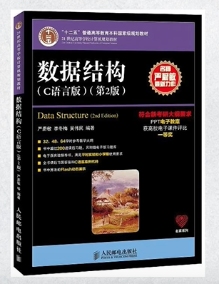
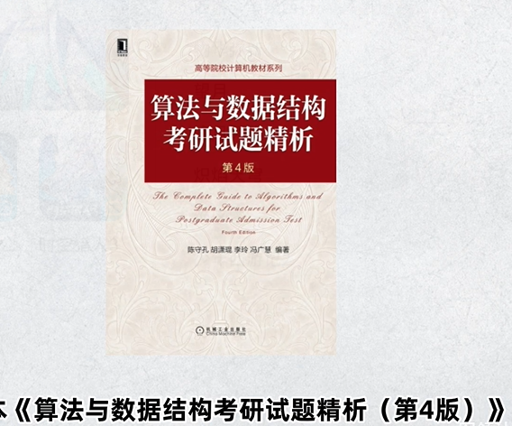
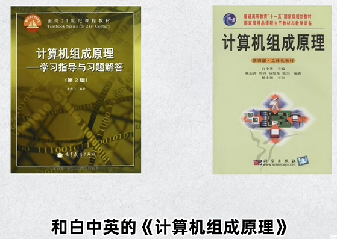
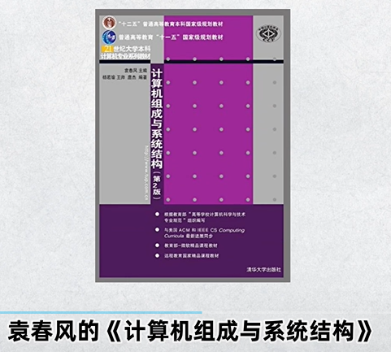
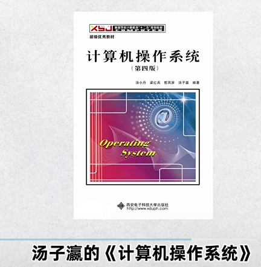
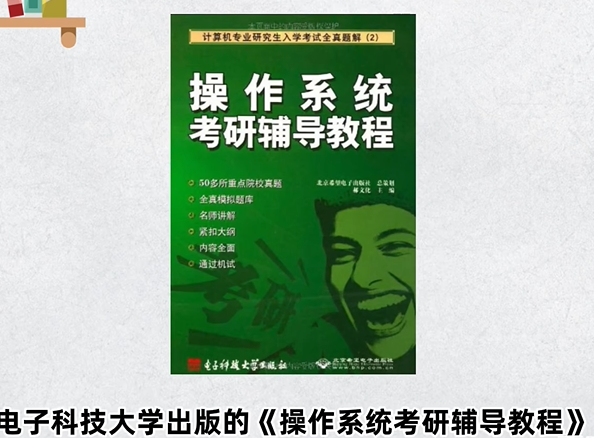
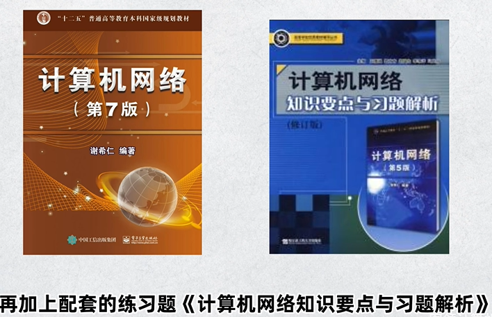

政治

肖秀荣《1000题》有时间就做徐涛和腿姐的

徐涛的强化课，重点马原和史纲

腿姐的《冲刺背诵手册》+腿姐技巧班

有时间《腿四》《徐六》

《肖八》选择题《肖四》选择题+大题背诵

有时间看其他老师的押题+时政、腿姐冲刺课押题课

刷题、肖四背诵苏一

张修齐十页纸

英语

阅读-写作-新题型-翻译-完型

《考研真相》

颉斌斌（基础）、唐迟阅读

monkey老师（百句实战、阅读）（全能）

**田静（基础）、**刘晓燕语法长难句

翻译唐静

完型宋逸轩

新题型刘琦

**石雷鹏、**王江涛作文

完型易熙人

刘晓燕保命班

数学

线代姜晓千

周洋鑫（基础）

张宇高数，线代，基础30讲、高数18讲

李永乐线代

汤家凤？、武忠祥高数

方浩、余丙森概率论

张宇真题

模拟：李林6套+4套？、张宇8套+4套、汤家凤8套、李永乐6套、合工大模拟卷5套、超越

有时间：

李永乐《660》全是选择填空题

李林押题？《880》《108》

第一版：数据结构1800题

数据结构 青岛大学的王卓老师

计算机组成原理 南京大学的袁春风老师、哈工大刘宏伟

操作糸统 哈工大的李治军老师

计算机网络 湖科大教书匠

偶数页：先奇数逆序，后偶数逆序。

单数页：先奇数逆序，拿掉最后一张，后偶数逆序。

半月谈的申论素材宝典

人民日报时评合集/半月谈素材和范文宝典

**决战行测5000题、决战申论100题**

齐麟刷题组

花生1200

刘文超资料刷题组

高照超大杯

粉笔APP

聂佳微博

花生十三公众号

欣说言语题集

郭熙言语100题

阿里木江言语

**中公真题**

粉笔真题套卷

资料分析：**高照****、****花生十三****、**齐麟、刘文超

判断:**聂佳****、****龙飞****主讲****图推****、****花生十三**

言语:**阿里木江****、****郭熙****、****花生十三、**刘文波

数量关系:**花生十三**、高照、齐麟、刘文超

常识:**李梦娇、**李卜、丹丹、马克

申论:**李梦圆****（基础）****、****站长（拔高）、袁东、小马哥、白鹭、飞扬**

考前找时政的冲刺、法律经济管理

中央一号文件

广东省十四五规划

广东省政府工作报告

申论我认为最重要的是要训练提炼概括的能力，就是要找准中心点，不写废话，这个能力非常重要，需要多练多看材料，多复盘，能够清晰读通理顺材料的逻辑，看清楚题目，问什么答什么，所有的问题都在材料里，尽量用材料原词，不要自己搞一些所谓的高级词上去，答案精炼简洁，做好分段。大作文提前准备好模版，开头结尾每个段首的出彩小分句背模版直接套非常省时间，但前提是一定要把作文的中心论点和论据找准写对，不然背再多套路也是无济于事的。至于怎么找准论点就要仔细读题，理顺材料的逻辑和论点，这就又回到第一个问题，一定要训练概括和提炼的能力，以及找点（即找中心论点）的能力

能被选为申论的材料都是很有水平的，你所说的理不清楚逻辑的问题我认为是需要多读多练，量变达到质变。答案不要以任何一个机构的答案为准，把它们当做参考，自己多做几遍原题，每次答题肯定都是会越来越精炼越来越完美的。如果说感觉到自己对于提炼和理逻辑这块比较无法入门，那我建议你大量读各个地方的申论材料，尝试自己用一句话概括每一段材料的要点，再把这些要点串起来整体读一遍，这就是整篇文章的写作逻辑

小程序：粉笔快练、行测小助手/数资、时政天天练、逻辑填空大师、图形推理大师、公考申论、申论小题秘籍